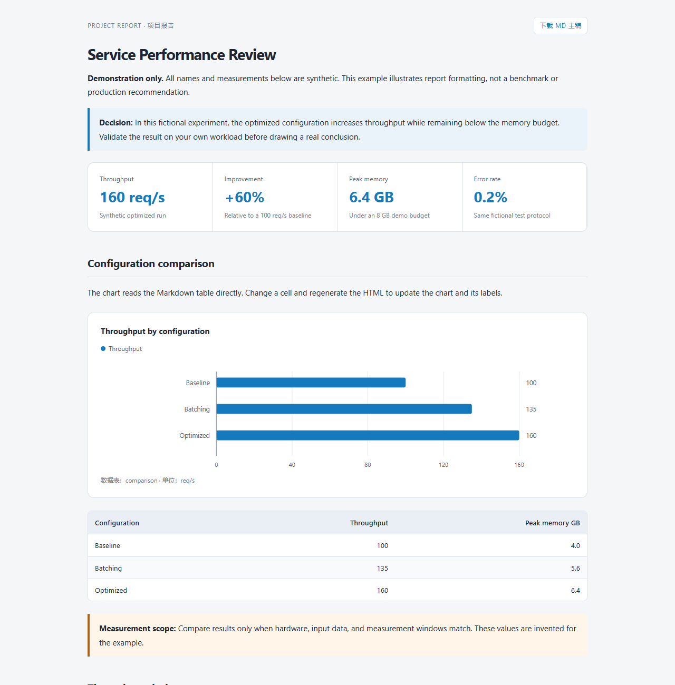

# Project Report Skill

[中文说明](README.zh-CN.md) · [MIT license](LICENSE) · [Format reference](skills/project-report/references/format.md)

An Agent Skill for creating **editable Markdown reports and polished, offline HTML from the same source**. Highlight conclusions with metric cards, callouts, tables, and data-driven SVG charts. Built for Codex; the renderer also runs as a standalone Python script.



## Features

- Markdown is the source of truth for both prose and data.
- Bar and line charts reference ordinary Markdown tables; no duplicated chart values.
- Metric cards, GitHub-style callouts, heading navigation, code blocks, and readable tables.
- Self-contained CSS and SVG; no chart CDN, API key, tracking, or remote service required.
- Download the exact Markdown snapshot from the generated HTML.
- Responsive layout, horizontally scrollable wide charts, and print styles.
- Invalid chart data fails visibly. A failed build preserves the previous HTML.

## Quick start

Requires Python 3.10+ and `markdown-it-py>=3,<5`.

```bash
git clone https://github.com/yxue301603/project-report-skill.git
cd project-report-skill
python -m venv .venv
```

Activate the environment with `.venv\Scripts\Activate.ps1` on PowerShell or `source .venv/bin/activate` on macOS/Linux, then:

```bash
python -m pip install -r skills/project-report/requirements.txt
python skills/project-report/scripts/render_report.py skills/project-report/assets/example.md
```

Open `skills/project-report/assets/example.html` in a browser. The example uses **synthetic demonstration data**, not real project measurements. A prebuilt copy is available at [docs/example.html](docs/example.html); download it to view locally (GitHub's source view does not render arbitrary HTML).

## Install as a skill

Copy the complete `skills/project-report` directory into your host's skill directory, preserving the folder name `project-report`. For Codex, use your personal skills directory, or `.agents/skills/project-report` inside the target repository. Install the Python dependency into the environment used by that host.

Example personal installation for Codex:

```powershell
# Windows PowerShell; refuses to replace an existing installation.
$skillRoot = if ($env:CODEX_HOME) { Join-Path $env:CODEX_HOME 'skills' } else { Join-Path $env:USERPROFILE '.codex/skills' }
$target = Join-Path $skillRoot 'project-report'
if (Test-Path -LiteralPath $target) { throw 'Existing skill found; review before updating.' }
New-Item -ItemType Directory -Path $skillRoot -Force | Out-Null
Copy-Item -LiteralPath './skills/project-report' -Destination $target -Recurse
```

```bash
# macOS / Linux; refuses to replace an existing installation.
skill_root="${CODEX_HOME:-$HOME/.codex}/skills"
mkdir -p "$skill_root"
if [ -e "$skill_root/project-report" ]; then
  echo 'Existing skill found; review before updating.'
else
  cp -R skills/project-report "$skill_root/project-report"
fi
```

In Codex, ask:

> Use $project-report to summarize this experiment. Deliver Markdown and HTML, highlight the main conclusion, and visualize the relevant comparisons.

To make this a project default, **optionally** add the following to that project's `AGENTS.md`:

> For formal project reports, use the project-report skill and deliver matching Markdown and HTML files. Treat Markdown as the source of truth and regenerate HTML after edits. Explicit user format requests take precedence. Do not apply this rule to ordinary chat replies, README files, or short instructions.

Installing the repository does not modify your agent's global instructions automatically.

## Author a report

Write normal Markdown and give a data table an identifier:

````markdown
# Throughput review

<!-- report:table results -->
| Configuration | Throughput |
| --- | ---: |
| Baseline | 100 |
| Optimized | 160 |

```report-chart
{"type":"bar","title":"Throughput comparison","table":"results","label":"Configuration","values":["Throughput"],"unit":"req/s"}
```
````

```bash
python skills/project-report/scripts/render_report.py report.md
python skills/project-report/scripts/render_report.py report.md --watch
python skills/project-report/scripts/render_report.py report.md --output preview.html
```

`--watch` rebuilds after Markdown saves; refresh the browser to view the result. Stop with Ctrl+C. See the [format reference](skills/project-report/references/format.md) for metric cards, callouts, chart options, numeric formats, and limitations.

## Limitations

- HTML is a generated view, not an in-browser editor; changes do not sync back to Markdown.
- External images are not bundled. Keep relative assets beside the HTML or package them separately; if using `--output` in another directory, adjust relative image paths accordingly.
- Line-chart x positions are equally spaced by row, not continuous numeric or timestamp axes.
- No automatic data analysis, formula calculation, Mermaid, or math typesetting.
- Raw HTML is escaped, but reports can still include external links and Markdown images. Review content before sharing or opening reports from untrusted sources.
- The HTML includes a downloadable copy of the entire Markdown source, including comments. Do not put secrets or private notes in a report you intend to share.

## Development

```bash
python skills/project-report/scripts/test_render_report.py
python -m pip install PyYAML
python scripts/validate_package.py
```

CI runs functional tests and package checks on Linux and Windows with Python 3.10 and 3.13. See [CONTRIBUTING.md](CONTRIBUTING.md), [CODE_OF_CONDUCT.md](CODE_OF_CONDUCT.md), and [SECURITY.md](SECURITY.md).

## License

MIT. The public package contains a generic template and synthetic examples. Private reference reports, machine paths, and credentials are not distributed. This is an independent community project, not an official OpenAI product.
