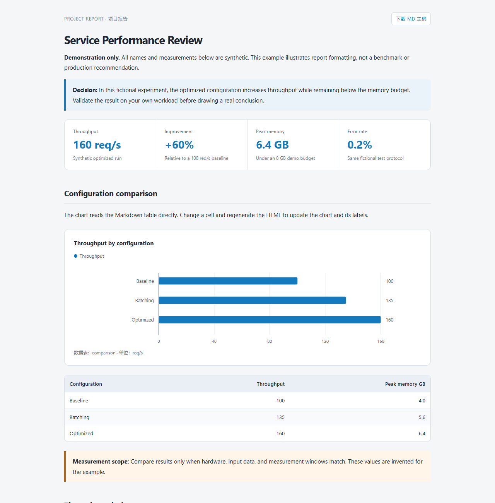

# 双格式项目报告 Skill

[English](README.md) · [MIT 许可证](LICENSE) · [完整格式说明](skills/project-report/references/format.md)

**编辑 MD，生成漂亮的 HTML。** 正文和数据只维护一份，展示版通过指标卡片、重点提示、表格和 SVG 图表突出重点。支持 Codex，也可以独立运行 Python 脚本。



## 快速体验

需要 Python 3.10+。在项目虚拟环境中运行：

```bash
git clone https://github.com/yxue301603/project-report-skill.git
cd project-report-skill
python -m pip install -r skills/project-report/requirements.txt
python skills/project-report/scripts/render_report.py skills/project-report/assets/example.md
```

打开生成的 `skills/project-report/assets/example.html`。也可以下载仓库中的 [HTML 示例](docs/example.html) 后用浏览器打开。示例全为**虚构演示数据**，不代表真实测试结果。

## 在 Codex 中使用

将 `skills/project-report` 完整复制到个人 skills 目录，或项目的 `.agents/skills/project-report`。个人安装与虚拟环境的跨平台命令见 [英文 README](README.md#install-as-a-skill)。已有同名 Skill 时先比较差异，不要直接覆盖。

使用时说：

> 使用 $project-report 整理本次实验报告，同时输出 MD 和 HTML，突出结论和关键对比。

需要默认应用时，可以自行在项目 `AGENTS.md` 中增加：

> 正式项目报告默认使用 project-report Skill，同时交付同名 MD 与 HTML；MD 为主稿，修改后重新生成 HTML。普通聊天、README 和简短操作说明不套用；用户明确指定其他格式时优先遵从。

本仓库不会自动改写个人全局规则。

## 编辑与同步

1. 编辑 MD 正文与普通 Markdown 数据表。
2. 图表用 `report-chart` 配置引用表格，不重复保存数值。
3. 重新生成 HTML：

```bash
python skills/project-report/scripts/render_report.py report.md
python skills/project-report/scripts/render_report.py report.md --watch
```

`--watch` 在保存主稿后自动生成，浏览器需手动刷新；Ctrl+C 停止。不要直接改 HTML 正文，下次生成会覆盖。

## 支持范围

- 指标卡片、重点提示、横向分组条形图、等间隔折线图。
- 支持多序列、正负值、百分数；拒绝缺失或无效图表数值。
- HTML 内置 CSS、SVG 和 MD 下载，图表无需联网。
- 外部图片需另外保留；不支持公式计算、Mermaid、数学公式排版或网页反向编辑。
- HTML 下载包含整个 MD（包括注释），公开前需清理私密内容。

更多说明见[格式约定](skills/project-report/references/format.md)。欢迎通过 Issue 和 PR 改进，参与前请阅读[贡献指南](CONTRIBUTING.md)与[行为准则](CODE_OF_CONDUCT.md)。

MIT 开源。社区包不包含原始私人参考报告、本机配置或凭据。
